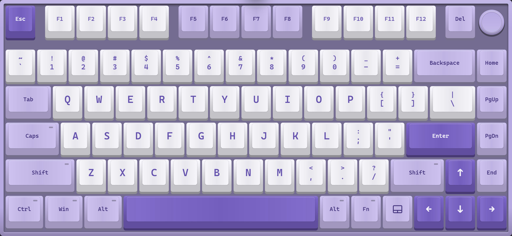
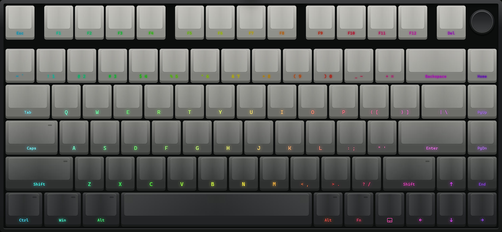
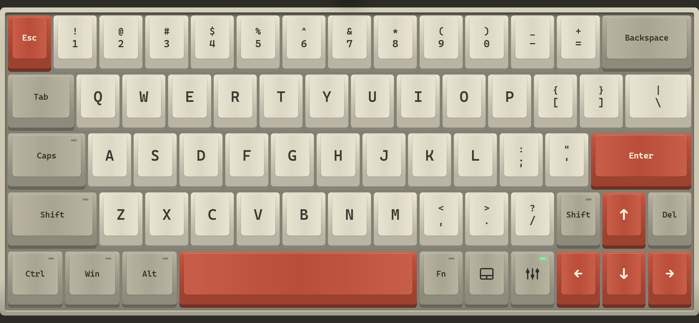

  

<h1 align="center">thock</h1>

Your phone is a mechanical keyboard.

  <a href="https://thock.lh3k.dev">Website</a> ·
  <a href="https://github.com/Nyaughh/thock/releases/latest">Download for Android</a>

Thock turns an Android phone or tablet into a full-screen 75% keyboard and trackpad. It pairs over Bluetooth like a real one, so there is nothing to install on the computer.

- Thirteen switch sounds, all recordings of real switches.
- Colourways after the Aula F75 and Rainy75, six keycap profiles, lit legends.
- A trackpad, one key away.

### Pair it

1. Download `thock.apk` from [Releases](https://github.com/Nyaughh/thock/releases/latest) on the phone and open it to install.
2. Open Thock and allow the **Nearby devices** permission.
3. Tap **Make this phone visible**.
4. On the computer, open Bluetooth settings, add a device, and pick the phone.

Next time, open Thock and it reconnects on its own. Android 9 or newer.

On an iPhone or iPad, Thock runs in the browser over Wi-Fi with a small program on a Windows PC. That, and everything else, is in the [guide](docs/GUIDE.md).

### App preview

  

  
  

Try it in the browser at [thock.lh3k.dev](https://thock.lh3k.dev).

MIT licence. Switch recordings from [kbsim](https://github.com/tplai/kbsim) by Thomas Lai.
